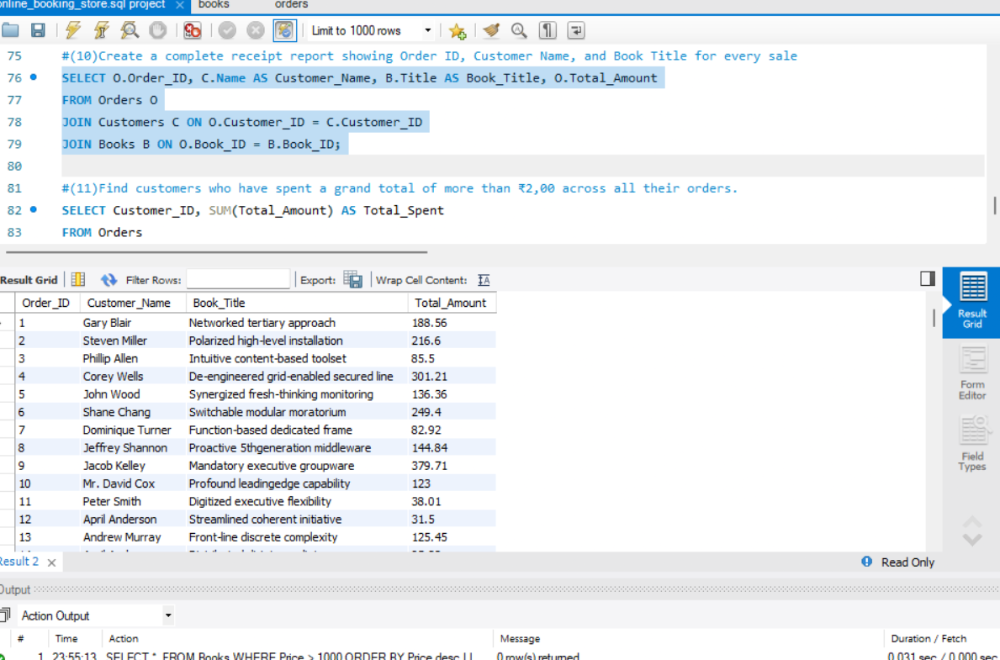

# Online Books Store: SQL Analysis
## Project Overview
SQL analysis of an online books store's data, to find out which customers and books bring in the most sales.
This project was completed as part of the Data Analyst course at IT Vedant.

## Dataset
The database has 3 tables:
- **Books**: book details (Book_ID, ...)
- **Customers**: customer details (Customer_ID, ...)
- **Orders**: order details (Order_ID, Customer_ID, Book_ID, Total_Amount, ...)

## Tools Used
- MySQL
- SQL

## What I Did
- Created the database and tables
- Added primary keys and foreign keys to link the tables
- Wrote queries to answer business questions

## Business Questions Answered
1. Which customers have the highest total sales?
2. Order details with customer names
3. (add the other questions from your file)

## Key Insights
- (write 2-3 findings, for example: "Top customer spent X")

## Files
- `queries.sql`: all SQL queries used in this project
